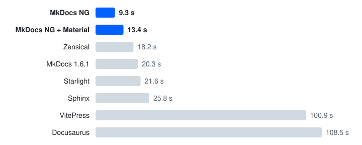

<p align="center">
  <a href="https://mkdocs-ng.org/">
    <picture>
      <source media="(prefers-color-scheme: dark)" srcset="https://raw.githubusercontent.com/mkdocs-ng/mkdocs/main/docs/img/logo-dark.svg">
      
    </picture>
  </a>
</p>

<h1 align="center">MkDocs NG</h1>

<p align="center">
  <strong>Write Markdown. Ship docs.</strong>
  <br>
  The maintained MkDocs that keeps your plugins working.
</p>

<p align="center">
  <a href="https://pypi.org/project/mkdocs-ng/"></a>
  <a href="https://pypi.org/project/mkdocs-ng/"></a>
  <a href="https://github.com/mkdocs-ng/mkdocs/actions/workflows/ci.yml"></a>
  <a href="https://mkdocs-ng.org/user-guide/migrating/#plugins-and-themes"></a>
  <a href="https://codecov.io/github/mkdocs-ng/mkdocs?branch=main"></a>
  <a href="https://app.codspeed.io/mkdocs-ng/mkdocs?utm_source=badge"></a>
  <a href="https://github.com/mkdocs-ng/mkdocs/blob/main/LICENSE"></a>
</p>

<p align="center">
  <a href="https://mkdocs-ng.org/">Documentation</a> ·
  <a href="https://mkdocs-ng.org/user-guide/migrating/">Switching from MkDocs</a> ·
  <a href="https://mkdocs-ng.org/about/release-notes/">Release notes</a> ·
  <a href="https://github.com/mkdocs-ng/catalog">Plugin catalog</a>
</p>

MkDocs is a **fast**, **simple**, and **downright gorgeous** static site
generator that's geared towards building project documentation. Documentation
source files are written in Markdown and configured with a single YAML
configuration file. It is designed to be easy to use and can be extended with
third-party themes, plugins, and Markdown extensions.

<p align="center">
  <a href="https://mkdocs-ng.org/about/comparison/#build-speed">
    <picture>
      <source media="(prefers-color-scheme: dark)" srcset="https://raw.githubusercontent.com/mkdocs-ng/mkdocs/main/docs/img/build-speed-dark.svg">
      
    </picture>
  </a>
</p>

<p align="center">
  <i>Clean build of the same 1,000-page site. Zensical is faster when it reuses its cache and when <code>serve</code> shows an edit.
  <br>
  <a href="https://mkdocs-ng.org/about/comparison/#build-speed">How we measured</a></i>
</p>

> [!NOTE]
> **MkDocs NG** is a maintained fork of [mkdocs/mkdocs], published on PyPI as
> `mkdocs-ng` while keeping the `mkdocs` command, imports and configuration
> unchanged — a drop-in replacement.
>
> Highlights beyond the last upstream release: Python 3.10–3.15 support,
> built-in `llms.txt` and per-page Markdown output for LLMs and coding agents,
> search that finds programming keywords like `while` and `for`, faster
> builds with smaller site output, a stable Python API (`mkdocs.build()` /
> `mkdocs.serve()`), fully offline syntax highlighting with no CDNs or
> analytics, and many long-standing bug fixes — see
> [Fixed Upstream Issues][fixed-upstream] and the [release notes][release-notes],
> or browse [all merged changes][more].

Please see the [Documentation][mkdocs] for an introductory tutorial and a full user guide.

## Features

- Build static HTML files from Markdown files.
- Use Plugins and Markdown Extensions to enhance MkDocs.
- Use the built-in themes, third-party themes, or create your own.
- Publish your documentation anywhere that static files can be served.
- Much more!

## Installation

Install with pip:

```bash
pip install mkdocs-ng
```

To start a new site, install it together with the
[Sumi](https://sumi.mkdocs-ng.org/) theme and create a project. Pass `--theme`
to `mkdocs new` to pick another theme:

```bash
pip install "mkdocs-ng[sumi]"
mkdocs new my-docs
```

Switching from `mkdocs`? Just install MkDocs NG — the command, imports and
configuration stay exactly the same:

```bash
pip install -U mkdocs-ng
```

Plugins and themes depend on the `mkdocs` package, so upstream MkDocs gets
installed alongside. That's fine: MkDocs NG installs its files separately and
always takes precedence, so leave the upstream package installed. See
[Plugins, themes and the `mkdocs` package][plugins-install] for details, and
[Switching to MkDocs NG][migrating] for what behaves differently from upstream
MkDocs.

## Support

If you need help with MkDocs:

- Use **[Discussions]** for questions and general help.
- To report a bug or make a feature request, open an **[Issue]** on GitHub.

We may only provide support for core MkDocs features. Questions about
third-party themes, plugins, or extensions should usually go to those projects
first, but they are still welcome in [Discussions].

## Links

- [Official Documentation][mkdocs]
- [Latest Release Notes][release-notes]
- [Fixed Upstream Issues][fixed-upstream]
- [Switching to MkDocs NG][migrating]
- [Comparison with upstream MkDocs 2.0, ProperDocs and Zensical][comparison]
- [Catalog of third-party plugins, themes and recipes][catalog]
- [Sumi][sumi], a local-first documentation theme from the MkDocs NG project
- [MkDocs NG Material][ng-material], Material for MkDocs maintained for MkDocs NG

## Contributing to MkDocs

The MkDocs project welcomes and depends on contributions from developers and
users in the open source community. Please see the [Contributing Guide] for
information on how you can help.

## Code of Conduct

Everyone interacting in the MkDocs project's codebases, issue trackers, and
discussion forums are expected to follow the [PyPA Code of Conduct].

<!-- Links -->
[mkdocs]: https://mkdocs-ng.org/
[mkdocs/mkdocs]: https://github.com/mkdocs/mkdocs
[more]: https://github.com/mkdocs-ng/mkdocs/pulls?page=1&q=is%3Apr+is%3Aclosed+is%3Amerged
[Issue]: https://github.com/mkdocs-ng/mkdocs/issues
[Discussions]: https://github.com/orgs/mkdocs-ng/discussions
[release-notes]: https://mkdocs-ng.org/about/release-notes/
[fixed-upstream]: https://mkdocs-ng.org/about/fixed-upstream-issues/
[plugins-install]: https://mkdocs-ng.org/user-guide/installation/#plugins-themes-and-the-mkdocs-package
[migrating]: https://mkdocs-ng.org/user-guide/migrating/
[comparison]: https://mkdocs-ng.org/about/comparison/
[Contributing Guide]: https://mkdocs-ng.org/about/contributing/
[PyPA Code of Conduct]: https://www.pypa.io/en/latest/code-of-conduct/
[catalog]: https://github.com/mkdocs-ng/catalog
[sumi]: https://github.com/mkdocs-ng/mkdocs-sumi
[ng-material]: https://github.com/mkdocs-ng/mkdocs-material

## License

[BSD-2-Clause](https://github.com/mkdocs-ng/mkdocs/blob/main/LICENSE)
